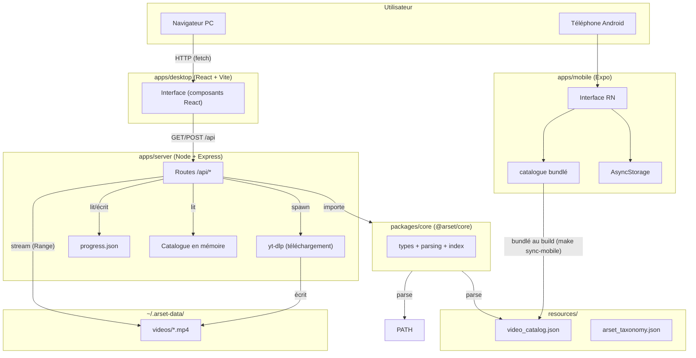

# 01 — Architecture

## Vue d'ensemble

Le projet est un **monorepo** : un seul dépôt Git qui contient plusieurs applications
(`apps/`) et bibliothèques partagées (`packages/`), toutes reliées par **npm workspaces**.

```
Arset_program/
├── Makefile                   # orchestration des commandes (dev / build / export)
├── package.json               # racine : définit les "workspaces" et les scripts
├── docs/                      # cette documentation
├── resources/                 # 🗂 données centralisées (committées, légères)
│   ├── catalog/               #   video_catalog.json + arset_taxonomy.json
│   └── notes/                 #   Plan.md, notes.md, transcripts
├── packages/
│   └── core/                  # @arset/core — code partagé (types + logique)
└── apps/
    ├── server/                # @arset/server — backend Node/Express
    ├── desktop/               # @arset/desktop — app React (Vite) pour PC
    └── mobile/                # @arset/mobile — app Expo / React Native (Android)
```

Et **hors du repo** (généré à l'exécution) :

```
~/.arset-data/
├── videos/<video_id>.mp4      # vidéos téléchargées à la demande
└── progress.json              # progression (modules terminés / vidéos vues)
```

## Rôles

| Composant | Techno | Rôle |
|---|---|---|
| `resources/` | JSON + Markdown | **Source de vérité** des données (catalogue des vidéos, parcours, notes). |
| `packages/core` | TypeScript (compilé en CJS) | Types et fonctions partagés : parsing du catalogue, index, formatage des durées. |
| `apps/server` | Node.js + Express | API HTTP : sert le catalogue, déclenche `yt-dlp`, streame les fichiers locaux, sauve la progression. |
| `apps/desktop` | React + Vite | Interface PC dans le navigateur. Appelle l'API. |
| `apps/mobile` | Expo / React Native | Interface Android. Bundle le catalogue, lit via YouTube (WebView), progression locale. |

## Pourquoi ce découpage ?

- **Une seule source de vérité** (`resources/`) consommée par les 3 apps.
- **`@arset/core`** évite de dupliquer le code de lecture du catalogue entre le server
  et le desktop.
- **Le backend est séparé** du frontend : le frontend ne sait pas télécharger les vidéos
  lui-même (le navigateur ne peut pas lancer `yt-dlp`) ; c'est le serveur qui le fait.

## Diagramme d'architecture



## La compilation de `@arset/core` (important)

`@arset/core` est écrit en TypeScript mais **compilé en JavaScript CommonJS** (`dist/`),
car il est consommé par Node (le serveur). Le frontend React le consomme aussi, mais Vite
doit le pré-bundler pour le navigateur — c'est pourquoi `apps/desktop/vite.config.ts`
contient :

```ts
optimizeDeps: { include: ["@arset/core"] },          // pour le serveur de dev
build: { commonjsOptions: { include: [/packages\/core/] } }, // pour le build prod
```

Sans ces deux lignes, le navigateur recevrait du CommonJS qu'il ne sait pas exécuter
(→ page blanche). C'est le bug corrigé en cours de développement.

## Ports et variables d'environnement

| Variable | Défaut | Usage |
|---|---|---|
| `PORT` | `4000` | Port du backend |
| `ARSET_DATA_DIR` | `~/.arset-data` | Dossier des données runtime |
| `ARSET_CATALOG_PATH` | (auto-détecté) | Chemin vers `video_catalog.json` |

Le backend (4000) et le frontend de dev (5173) sont reliés par le **proxy Vite**
(`/api` → `http://localhost:4000`).
