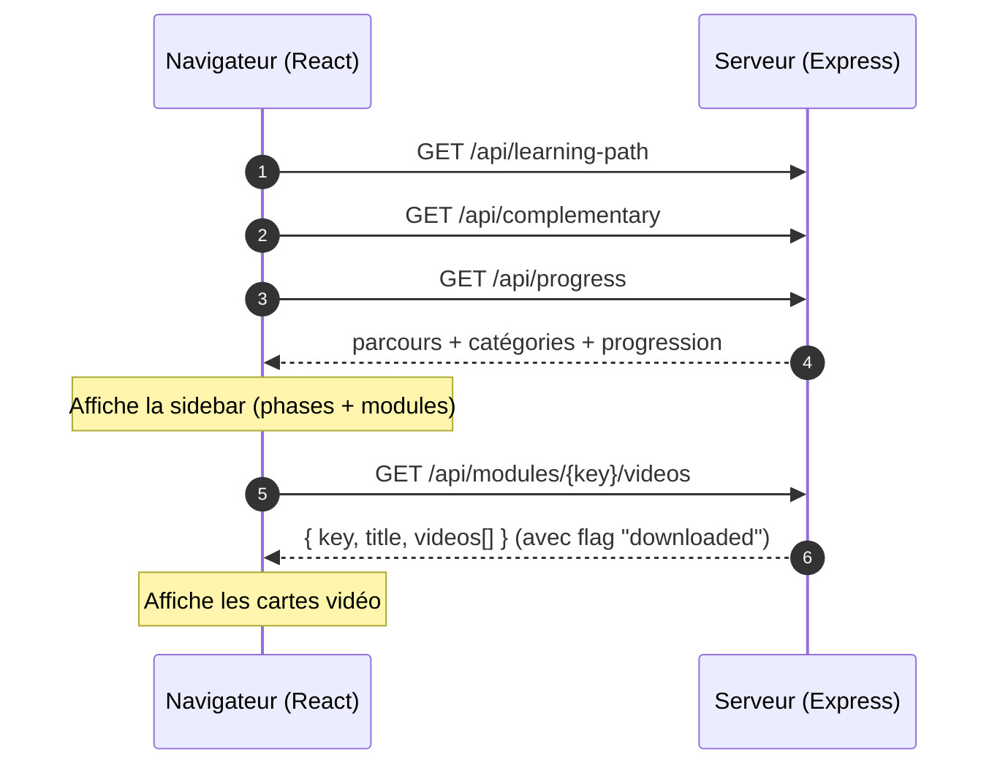
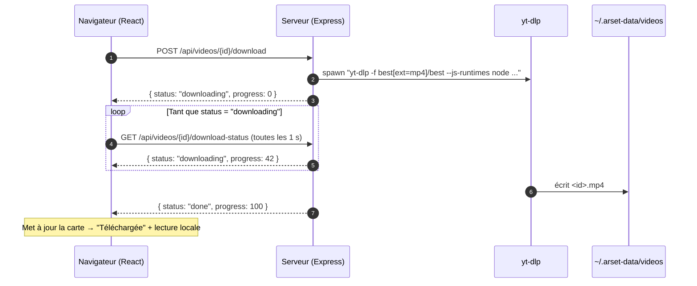
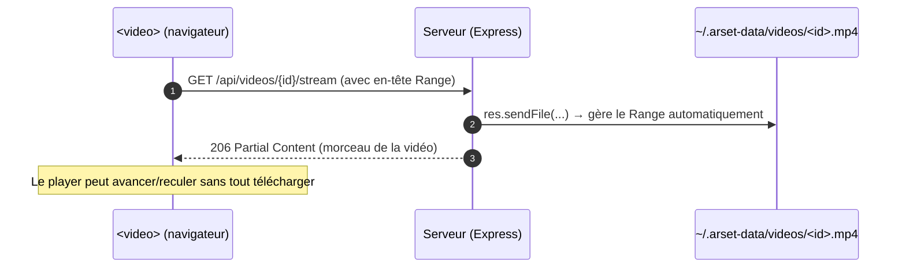
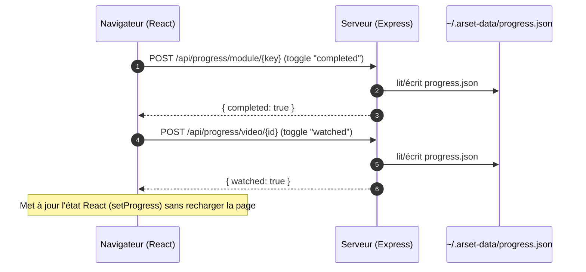
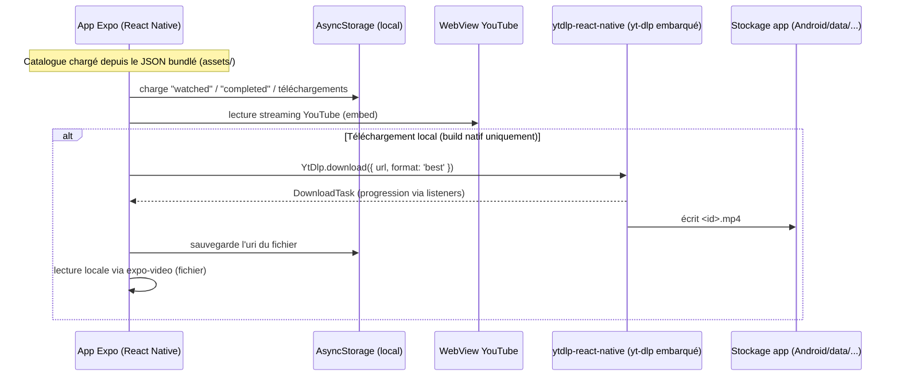

# 02 — Diagrammes de séquence

Ces diagrammes décrivent les interactions au fil du temps (qui appelle qui, dans quel ordre).
Les acteurs sont : le **Navigateur** (React), le **Serveur** (Express) et **yt-dlp**.

## 1. Chargement initial et navigation

Détail côté React : `App.tsx` fait un `useEffect` au montage qui appelle les trois
premières routes en parallèle (`Promise.all`), puis `selectModule()` charge les vidéos
d'un module quand l'utilisateur clique.

## 2. Téléchargement à la demande

Côté React, c'est `VideoCard` qui gère le polling : `startDownload()` POST puis un
`setInterval` de 1 s interroge `download-status` jusqu'à `done` ou `error`.

## 3. Lecture locale (stream avec HTTP Range)

Quand la vidéo est téléchargée, le `<video>` du navigateur lit le fichier local via le serveur.

## 4. Progression (marquer terminé / marquer vue)

## 5. Application mobile (autonome)

Sur Android, il n'y a **aucun serveur** : le catalogue est bundlé, la lecture passe par
YouTube, et le téléchargement est fait **directement sur l'appareil** via yt-dlp embarqué.

