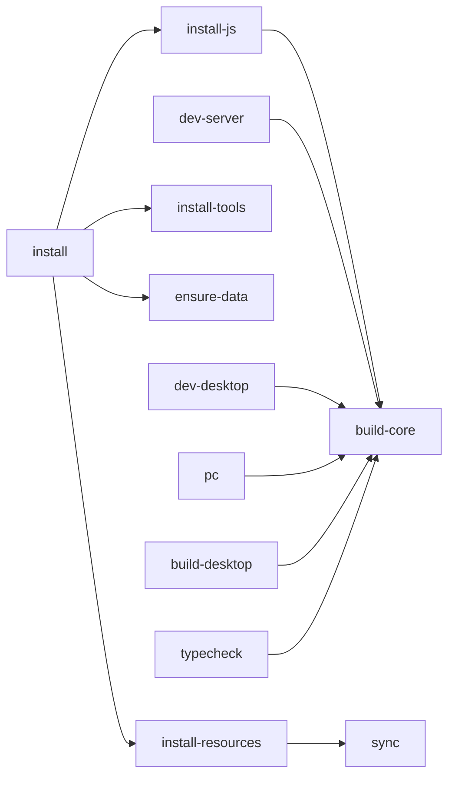

# 07 — Workflows : commandes et exports

## Commandes Makefile

| Commande | Description |
|---|---|
| `make install` | Installe **tout** (JS + ressources + outils + SDK Android + data dir) |
| `make sync` | Re-copie catalogue + notes depuis la source |
| `make pc` | Backend (4000) + desktop (5173) en parallèle |
| `make dev-server` | Backend seul (dev) |
| `make dev-desktop` | Desktop seul (dev) |
| `make dev-mobile` | Expo (dev Android) |
| `make build-core` | Compile `@arset/core` |
| `make build-desktop` | Build production React |
| `make build-android` | Build local Android (vérifie JDK/SDK puis compile via USB) |
| `make android-eas` | APK via EAS (cloud, sans SDK local) |
| `make android-check` | Vérifie les prérequis du build local (sans installer) |
| `make android-login` | Connexion compte Expo (une fois) |
| `make typecheck` | Typecheck (core + server + desktop + mobile) |
| `make test` | Tests `@arset/core` |
| `make clean` | Nettoie `node_modules` + artefacts |
| `make help` | Aide |

## Desktop (PC)

### Développer

```bash
make pc            # → http://localhost:5173
```

### Exporter (production)

```bash
make build-desktop     # génère apps/desktop/dist/
```

`dist/` est un site **statique**, servable n'importe où :

```bash
npm run preview -w @arset/desktop   # aperçu local
npx serve apps/desktop/dist         # ou un serveur statique quelconque
```

> ⚠️ En production, `/api` doit pointer vers le backend. En dev c'est le proxy Vite qui
> s'en charge. Pour la prod : reverse-proxy (nginx) devant le serveur Express, ou
> recompiler le frontend avec l'URL du backend (variable d'env Vite).

### Version web statique (GitHub Pages)

Sans backend, le desktop peut être buildé en **site 100 % statique** et hébergé sur
GitHub Pages : `https://arnaudsomville.github.io/Arset_program/`.

```bash
make build-desktop-pages      # ou : npm run build:pages -w @arset/desktop
```

Ce build (`--mode pages`) :

- copie `resources/catalog/video_catalog.json` + `resources/learning_path.json` dans
  `apps/desktop/public/data/` (via `scripts/sync-data.mjs`) ;
- calcule l'index côté navigateur avec `@arset/core` (aucun serveur) ;
- persiste la progression dans **`localStorage`** (par navigateur, non synchronisée) ;
- **désactive le téléchargement local** (yt-dlp est impossible dans un navigateur) ;
  la lecture se fait via l'iframe YouTube ;
- utilise une `base` Vite `/Arset_program/` (configurée dans `vite.config.ts` selon le mode).

`src/api.ts` choisit automatiquement l'implémentation : client HTTP (back-end, dev) ou
client statique (`src/staticApi.ts`, mode `pages`).

> Déploiement : `.github/workflows/pages.yml` build `@arset/core` + le desktop puis publie
> `apps/desktop/dist`. Déclenchement sur push `main` (fichiers concernés) ou manuel.
> **Une seule fois** : activer Pages dans *Settings → Pages → Source = GitHub Actions*.

## Android

> ⚠️ Le **téléchargement local** repose sur un module natif local (`modules/youtubedl`,
> basé sur la lib `youtubedl-android` qui embarque yt-dlp + Python), donc il
> **ne fonctionne pas dans Expo Go** : il faut un **build natif** (EAS ou local).
> Le streaming, la navigation et la progression, eux, marchent dans Expo Go.

Trois chemins :

### A. Expo Go (dev rapide, streaming seulement)

```bash
make dev-mobile     # scan le QR avec Expo Go
```

### B. EAS (cloud) — aucun SDK/câble

```bash
make android-login   # une seule fois (compte Expo gratuit)
make android-eas     # APK autonome (lien de téléchargement)
```

Optionnel : `make android-dev-client` (client de développement pour itérer avec Metro),
ou `cd apps/mobile && npx eas-cli build -p android --profile production` (AAB Play Store).

### C. Local (USB) — build sur ton PC

```bash
make install         # installe JDK 17+ + SDK Android si absents (une fois, ~3-4 Go)
make build-android   # vérifie les prérequis puis compile + installe via adb
```

`make build-android` dépend de `android-check` (script `scripts/check-android.sh`) qui
**vérifie JDK 17+ / adb / SDK / appareil** et **plante** avec les instructions si un
prérequis manque. `make install` installe le JDK (Temurin 21) et le SDK dans
`~/Android/Sdk` **s'il ne sont pas déjà là** (sans sudo, via `scripts/install-android-sdk.sh`).

### D. CI (GitHub Actions) — APK reproductible

`.github/workflows/android.yml` : `checkout → node 22 → JDK 21 → SDK → npm ci →
expo prebuild → gradlew assembleRelease → upload de l'APK`. Déclenchement manuel
(`workflow_dispatch`) ou sur tag `v*`. APK signé debug (installable), téléchargeable
depuis l'onglet **Actions** (artefact).

`apps/mobile/eas.json` :

```json
{
  "build": {
    "preview":     { "distribution": "internal", "android": { "buildType": "apk" } },
    "development": { "developmentClient": true, "distribution": "internal", "android": { "buildType": "apk" } },
    "production":  { "autoIncrement": true }
  }
}
```

- `preview` → APK installable (lien de téléchargement EAS).
- `development` → client de développement (dev client).
- `production` → AAB pour le Play Store.

## Dépendance entre cibles



Le point important : **`@arset/core` doit être compilé avant** de lancer le serveur ou le
desktop, d'où la dépendance `build-core` partout.
