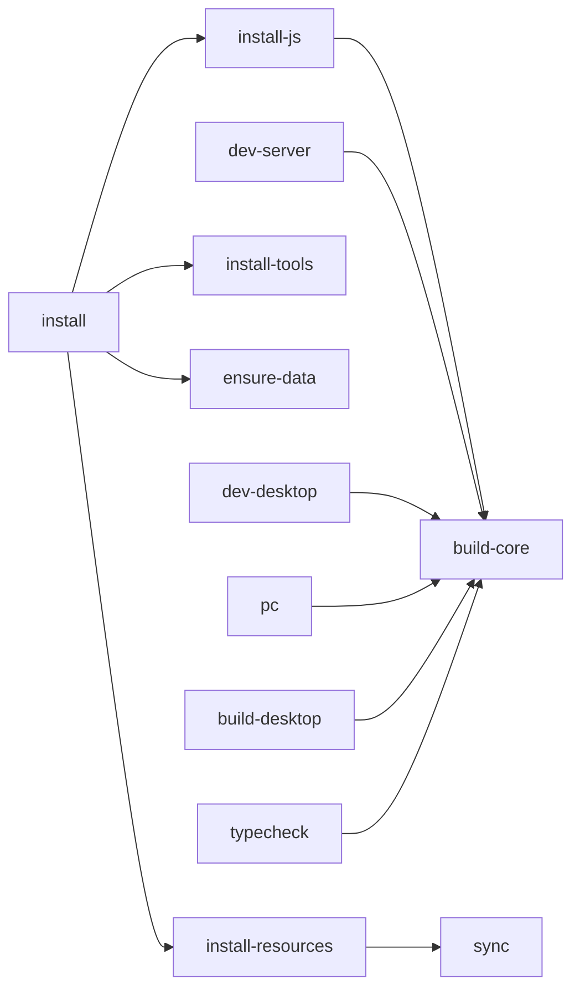

# 07 — Workflows : commandes et exports

## Commandes Makefile

| Commande | Description |
|---|---|
| `make install` | Installe **tout** (JS + ressources + outils + data dir) |
| `make sync` | Re-copie catalogue + notes depuis la source |
| `make pc` | Backend (4000) + desktop (5173) en parallèle |
| `make dev-server` | Backend seul (dev) |
| `make dev-desktop` | Desktop seul (dev) |
| `make dev-mobile` | Expo (dev Android) |
| `make build-core` | Compile `@arset/core` |
| `make build-desktop` | Build production React |
| `make android-eas` | APK via EAS (cloud, sans SDK local) |
| `make android-local` | Build + installation via USB (SDK local requis) |
| `make android-check` | Vérifie les prérequis du build local (sans installer) |
| `make android-login` | Connexion compte Expo (une fois) |
| `make typecheck` | Typecheck (core + server + desktop + mobile) |
| `make test` | Tests `@arset/core` |
| `make clean` | Nettoie `node_modules` + artefacts |
| `make help` | Aide |

## Desktop (PC)

### Développer

```bash
make pc            # → http://localhost:5173
```

### Exporter (production)

```bash
make build-desktop     # génère apps/desktop/dist/
```

`dist/` est un site **statique**, servable n'importe où :

```bash
npm run preview -w @arset/desktop   # aperçu local
npx serve apps/desktop/dist         # ou un serveur statique quelconque
```

> ⚠️ En production, `/api` doit pointer vers le backend. En dev c'est le proxy Vite qui
> s'en charge. Pour la prod : reverse-proxy (nginx) devant le serveur Express, ou
> recompiler le frontend avec l'URL du backend (variable d'env Vite).

## Android

> ⚠️ Le **téléchargement local** repose sur `ytdlp-react-native` (module natif yt-dlp),
> donc il **ne fonctionne pas dans Expo Go** : il faut un **build natif** (EAS ou local).
> Le streaming, la navigation et la progression, eux, marchent dans Expo Go.

Trois chemins :

### A. Expo Go (dev rapide, streaming seulement)

```bash
make dev-mobile     # scan le QR avec Expo Go
```

### B. EAS (cloud) — recommandé, aucun SDK/câble

```bash
make android-login   # une seule fois (compte Expo gratuit)
make android-eas     # APK autonome (lien de téléchargement)
```

Optionnel : `make android-dev-client` (client de développement pour itérer avec Metro),
ou `cd apps/mobile && npx eas-cli build -p android --profile production` (AAB Play Store).

### C. Local (USB) — build sur ton PC

Prérequis : **JDK 17+**, **Android Studio + SDK**, **`adb`**, téléphone en **débogage USB**.

```bash
make android-check    # vérifie les prérequis (échoue proprement sinon)
make android-local    # génère android/, compile, installe via adb
```

`make android-check` (script `scripts/check-android.sh`) ne **fait aucune installation** :
il contrôle JDK / adb / SDK / appareil, et sort en erreur avec les instructions si un
prérequis manque.

`apps/mobile/eas.json` :

```json
{
  "build": {
    "preview":     { "distribution": "internal", "android": { "buildType": "apk" } },
    "development": { "developmentClient": true, "distribution": "internal", "android": { "buildType": "apk" } },
    "production":  { "autoIncrement": true }
  }
}
```

- `preview` → APK installable (lien de téléchargement EAS).
- `development` → client de développement (dev client).
- `production` → AAB pour le Play Store.

## Dépendance entre cibles



Le point important : **`@arset/core` doit être compilé avant** de lancer le serveur ou le
desktop, d'où la dépendance `build-core` partout.
