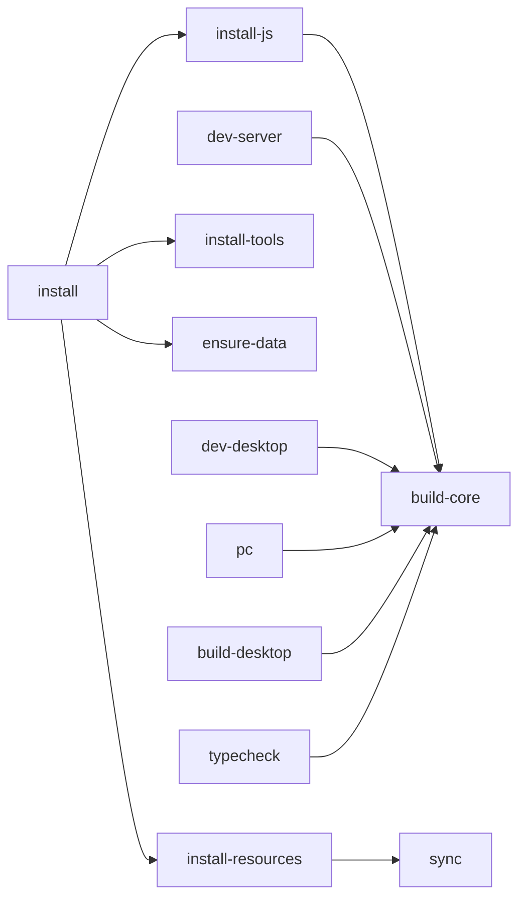

# 07 — Workflows : commandes et exports

## Commandes Makefile

| Commande | Description |
|---|---|
| `make install` | Installe **tout** (JS + ressources + outils + data dir) |
| `make sync` | Re-copie catalogue + notes depuis la source |
| `make pc` | Backend (4000) + desktop (5173) en parallèle |
| `make dev-server` | Backend seul (dev) |
| `make dev-desktop` | Desktop seul (dev) |
| `make dev-mobile` | Expo (dev Android) |
| `make build-core` | Compile `@arset/core` |
| `make build-desktop` | Build production React |
| `make build-android` | APK via EAS (cloud) |
| `make typecheck` | Typecheck (core + server + desktop + mobile) |
| `make test` | Tests `@arset/core` |
| `make clean` | Nettoie `node_modules` + artefacts |
| `make help` | Aide |

## Desktop (PC)

### Développer

```bash
make pc            # → http://localhost:5173
```

### Exporter (production)

```bash
make build-desktop     # génère apps/desktop/dist/
```

`dist/` est un site **statique**, servable n'importe où :

```bash
npm run preview -w @arset/desktop   # aperçu local
npx serve apps/desktop/dist         # ou un serveur statique quelconque
```

> ⚠️ En production, `/api` doit pointer vers le backend. En dev c'est le proxy Vite qui
> s'en charge. Pour la prod : reverse-proxy (nginx) devant le serveur Express, ou
> recompiler le frontend avec l'URL du backend (variable d'env Vite).

## Android

Trois chemins possibles :

### A. Expo Go (le plus rapide, aucun SDK)

```bash
make dev-mobile     # scan le QR avec Expo Go, ou appuie sur "a" (USB)
```

### B. Build natif local (installe un APK debug via USB)

Prérequis : Android Studio + SDK + JDK 17 + `adb`.

```bash
adb devices                 # vérifier que le téléphone est vu (débogage USB actif)
cd apps/mobile && npx expo run:android
```

### C. APK via EAS (cloud, partageable)

```bash
cd apps/mobile && npx eas-cli login   # une seule fois
make build-android                    # = eas build -p android --profile preview
```

`apps/mobile/eas.json` :

```json
{
  "build": {
    "preview":    { "distribution": "internal", "android": { "buildType": "apk" } },
    "production": { "autoIncrement": true }
  }
}
```

- `preview` → APK installable (lien de téléchargement donné par EAS).
- `production` → AAB pour le Play Store.

## Dépendance entre cibles



Le point important : **`@arset/core` doit être compilé avant** de lancer le serveur ou le
desktop, d'où la dépendance `build-core` partout.
